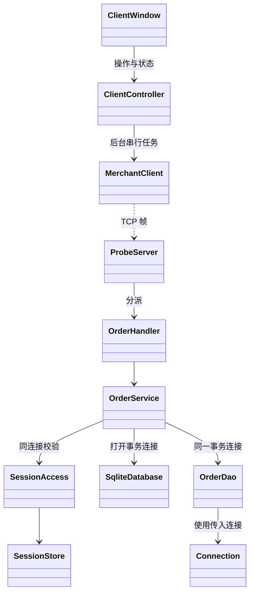
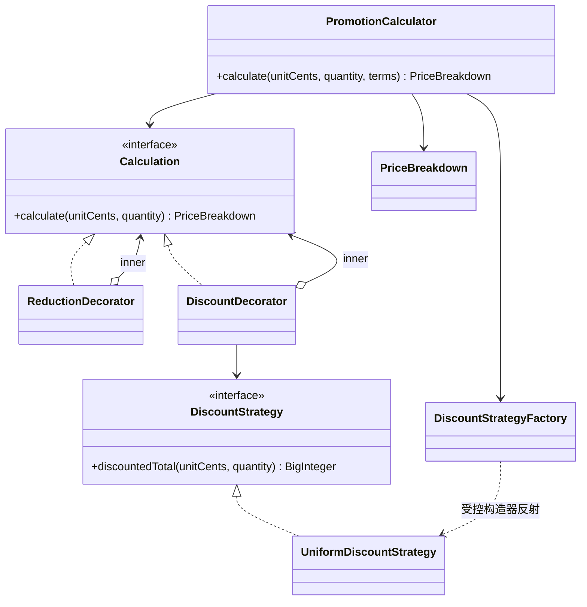
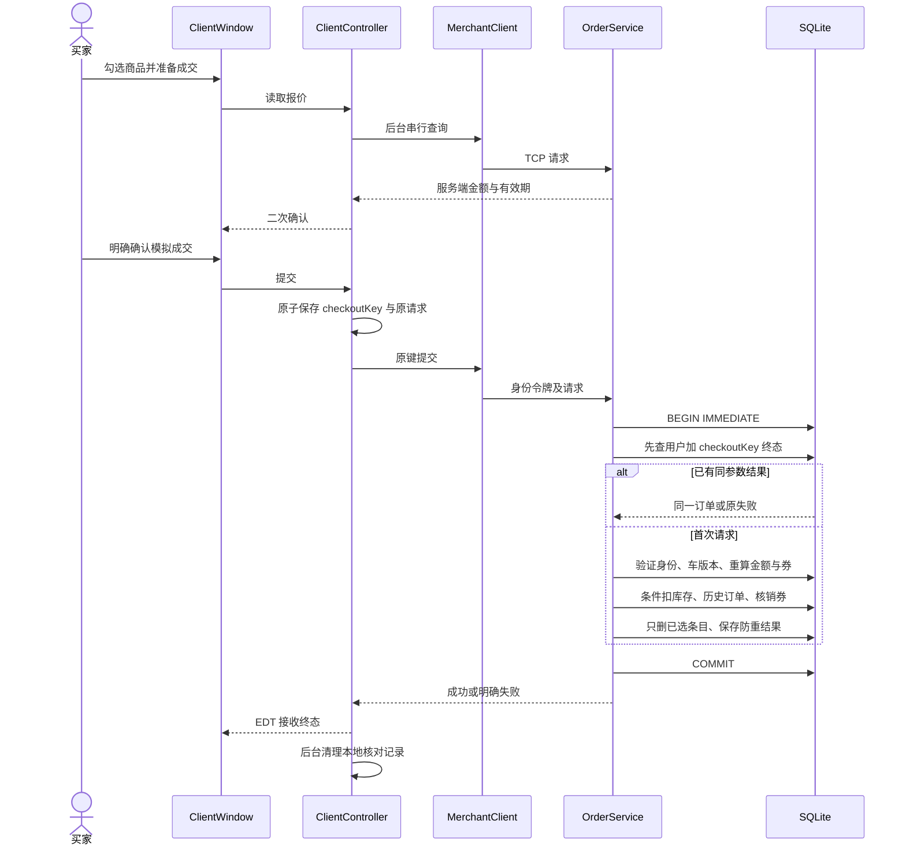
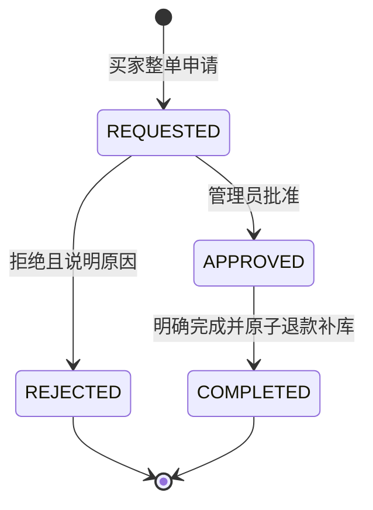
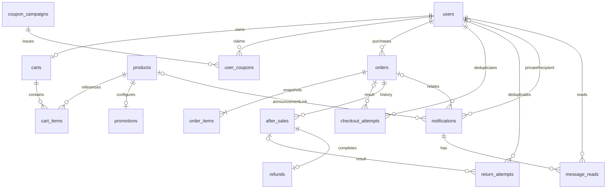

# 实现架构与 UML

本材料对应本仓库实际 Java 类，补充六篇历史报告，不声称已重新核验仓库外的课程 PPT。S14—S16 沿用既有四模块和依赖方向，主题只属于 desktop/UI，消息复用既有 TCP 请求队列及服务端事务。

## 模块与部署

买家端和服务端为两个独立进程。客户端不依赖服务端代码、不访问数据库；服务端测试范围依赖客户端，以验证真实 TCP 全链路，运行包不含客户端实现。

同样的分层适用于购物车、优惠券及售后。服务端管理面板调用本机应用服务，每次操作仍验证 ADMIN 会话及数据库中的账号状态。管理端退出只销毁管理窗口，不停止买家服务。

## 促销类及模式

下图中 Calculation、ReductionDecorator、DiscountDecorator 是 PromotionCalculator 的私有嵌套类型；它们在源码中实际存在，不是预留空壳。统一折扣按每件 HALF_UP 到分后乘数量，直降最低零元，计算链同时保留优惠步骤。

工厂只接受服务端白名单 UNIFORM，客户端不能传任意 Java 类名。预览、商品展示、购物车报价及成交重算复用同一计算实现。

## 原子成交时序

任一步业务操作失败回滚；提交后丢应答保留原请求核对，不能自动换键重买。事务内同步保存的通知和订单共同提交，不在返回成功后另扣库存。

## 售后状态

拒绝后可新申请并保留旧记录，属于新的售后对象；不能将旧拒绝记录改回 REQUESTED。同一订单最多一笔处理中或完成的售后。订单对应 COMPLETED → RETURN_REQUESTED → REFUNDED；拒绝则回到 COMPLETED。退款依据原实付，包括零元单，已用券不返还；完成重复请求不重复退款或补库存。

## 解释与限制

站内消息延续同一依赖方向：InboxPanel → ClientController → MerchantClient → ProbeServer → InboxHandler → InboxService → NotificationDao。管理端 AnnouncementPanel 直接调用本机 InboxService，逐次校验管理员身份。Theme/ThemeSettingsPanel/SurfacePanel 仅位于 desktop，不依赖 protocol 或 server，不把界面逻辑混入事务。

公开公告的notifications.user_id为空；message_reads按用户独立保存。通知事件键唯一，订单/售后操作的重复终态在生成通知前返回；首次操作在原事务中写通知，失败回滚业务。未采用后台可靠队列，不补造升级前的交易通知。

- Swing 的后台任务用于避免阻塞界面，与核心业务事务异步是两件事；核心成交和退款不拆成最终一致流程。
- 消息为站内持久化通知，不是聊天系统、系统通知或可靠消息中间件。
- 六篇报告作为历史资料保留；答辩演示以当前需求、源码、实际运行及验收材料为准。
