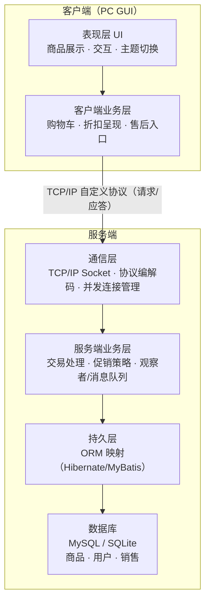
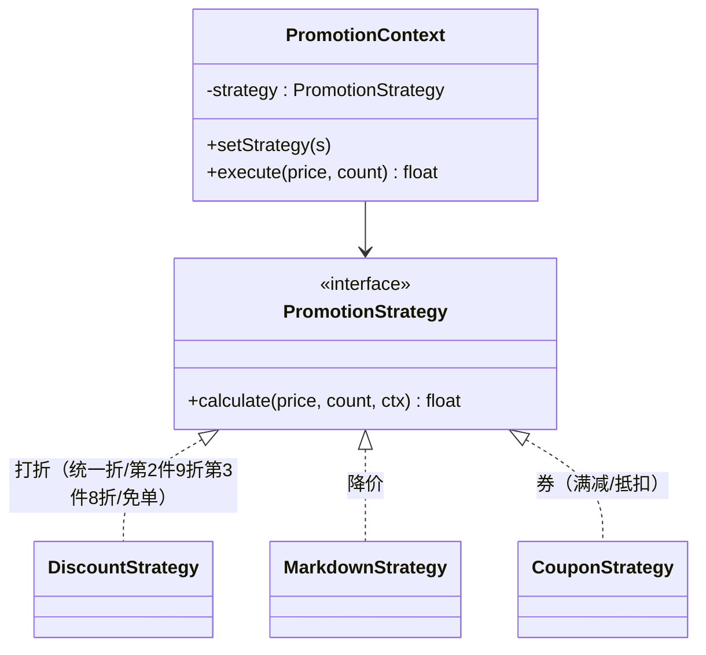
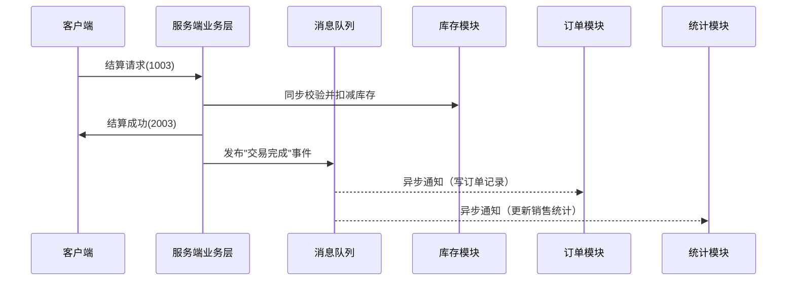

# 微商系统课程设计 — 深度理解与设计思路

> 本文档基于桌面《2026课程设计.pptx》（17 页）逐页精读整理，目的是把这份看似简略的任务书背后的**核心思想、教学目标、隐含要求**全部还原出来，让你对项目有一个"知其然更知其所以然"的深度理解。
>
> 配套文档：《微商系统课程设计-需求描述与技术讨论.md》负责回答"具体做什么（需求）"和"用什么做（技术）"。

---

## 目录

1. [项目一句话概括](#1-项目一句话概括)
2. [背景：什么是"微商系统"](#2-背景什么是微商系统)
3. [课程设计的定位与教学目标](#3-课程设计的定位与教学目标)
4. [PPT 逐页精读（17 页全解析）](#4-ppt-逐页精读)
5. [系统架构深度解析](#5-系统架构深度解析)
6. [核心设计思想提炼](#6-核心设计思想提炼)
7. [功能全景与业务主线](#7-功能全景与业务主线)
8. [技术亮点：促销系统的设计模式拆解](#8-技术亮点促销系统的设计模式拆解)
9. [难点与挑战清单](#9-难点与挑战清单)
10. [交付物与考核要求解读](#10-交付物与考核要求解读)
11. [落地建议与里程碑](#11-落地建议与里程碑)

---

## 1. 项目一句话概括

> **用 C/S（客户端/服务器）架构，从零手写一个"社交电商"系统（类拼多多/有赞/微店的 PC 版），完整走完"需求 → 设计 → 实现"的软件工程生命周期，重点训练分层架构、自定义通信协议、面向对象设计模式、并发与互斥这四类"硬功夫"，并且刻意不让你用现成的 Web 框架。**

它不是一个"做个能买东西的 App"这么简单的功能题，而是一个**架构与设计能力训练题**。功能（购物车、促销、结算）只是"载体"，真正考核的是载体的**搭法**。

---

## 2. 背景：什么是"微商系统"

### 2.1 微商 = 社交 + 零售

PPT 第 2 页点出了本质：

```
本质：社交 + 零售
常见模式：引流 + 吸粉 + 交易
```

"微商"这个词表面是"微信上的生意"，但课程设计要的其实是更广义的**社交电商（Social Commerce）**：把"人"和"关系"嵌入交易链条，靠社交裂变获得流量，靠零售完成变现。

### 2.2 参考平台拆解

PPT 列了这些参考对象（功能上类比手机淘宝、京东）：

| 平台 | 类型/特点 | 对项目的启示 |
|------|-----------|--------------|
| **拼多多** | 拼团、低价、社交裂变 | "拼团/多人参与"对应**并发**与**多用户** |
| **有赞 / 微店** | 商家开店工具、SaaS | 单店经营、商品管理、订单/售后 |
| **云集**（云集品） | 会员制社交零售 | 分销、会员等级 |
| **九大星王 / 京喜等** | 社交电商/特价 | 促销玩法多样（打折、券、限购） |
| **淘宝 / 京东** | 传统电商标杆 | 商品浏览、购物车、结算、售后全链路 |

> 注意：这些只是"功能对标"的参照物。课程**不要求**复刻它们的规模，而是抓住最小闭环：**看商品 → 加购物车 → 促销优惠 → 结算 → 售后**。

### 2.3 为什么说"我们要做的"是这些

第 2 页结尾"我们要做的"三个字，是要你把上面那一堆平台的功能**收敛成一个可落地的最小可交付系统**。收敛结果就是第 5 页的功能清单（详见 §7）。

---

## 3. 课程设计的定位与教学目标

从 17 页 PPT 反推，这本质是一门 **《软件工程 / 面向对象分析与设计 / 系统分析与设计》** 类课程的课程设计（Course Design），而非"数据库课程设计"或"纯 Web 开发课"。

### 3.1 它要训练的能力（隐性教学目标）

| 能力项 | PPT 证据（页码） | 训练方式 |
|--------|------------------|----------|
| **分层架构思维** | 3/4/7 页的 MVC + 四层图 | 强制 UI/业务/持久/数据库分层 |
| **架构选型判断** | 3 页 C/S、4 页 B/S、14 页"不建议 Web" | 理解两种架构的代价 |
| **面向对象设计** | 5 页"反射+策略+装饰"、8 页"观察者模式" | 用设计模式解决促销/异步 |
| **网络通信与协议设计** | 12 页"协议编码"、13 页"协议定义" | 自己定义应用层协议 |
| **并发与互斥** | 6 页"双9.9""爱马仕限量" | 多线程、锁、事务 |
| **持久化与 ORM 思想** | 9/10 页"持久层完成映射" | 理解对象↔关系映射 |
| **数据库/SQL** | 9/10/13 页 | 建库建表、SQL 读写 |
| **UML 建模** | 13 页 | 用例图/类图/时序图 |
| **软件工程生命周期** | 6 页"需求+设计+实现"、13 页"分析设计实现管理" | 全程按流程走 |
| **跨语言/异构系统** | 7/13 页"Java 服务器 + C++ 客户端" | 跨语言通信 |

### 3.2 一句话总结定位

**这是一个"去框架化"的综合实践**：故意剥掉 Web 框架、ORM 框架、消息中间件这些"黑盒"，逼你亲手把分层、协议、映射、并发这些底层机制**从原理层做出来**，从而真正理解一个企业级系统内部是怎么运转的。

---

## 4. PPT 逐页精读

下面把 17 页逐页拆解，标注每页的"字面意思"和"深层用意"。

### 第 1 页 — 标题：微商系统

定题。整份任务书围绕"微商系统"展开。

### 第 2 页 — 背景描述

- **字面**：手机 App；拼多多、云集、九大星王、有赞、微店；本质"社交+零售"；模式"引流+吸粉+交易"；功能类似淘宝/京东。
- **深层**：告诉你"做什么领域、对标谁"。关键词是 **"社交 + 零售"** 和 **"引流 + 吸粉 + 交易"** —— 这两组词决定了系统的业务骨架：既要有零售交易闭环，又要能体现"多用户/社交"特性（所以第 15 页要求"考虑多用户"）。

### 第 3 页 — C/S 框架

```
服务器和客户端都要安装程序
MVC 模式：
  客户端：UI / 业务层
  服务端：UI / 业务层 / 持久层 / 数据库
  通信：TCP/IP
```

- **字面**：C/S 架构，两端都要装程序，分层用 MVC，走 TCP/IP。
- **深层**：这是**架构候选方案 A**。特点是"重客户端"——客户端自己带业务逻辑，通过 TCP/IP 直接和服务端对话（区别于 B/S 的 HTTP+浏览器）。

### 第 4 页 — B/S 框架

```
服务器端程序 + 浏览器
MVC 模式：浏览器 / Web 容器 / 业务层 / 持久层 / 数据库
通信：HTTP
```

- **字面**：B/S 架构，客户端只要浏览器，服务端加一层"Web 容器"。
- **深层**：这是**架构候选方案 B**，和第 3 页形成对照。结合第 14 页"坚决不建议 Web 编程（封装太狠、陷入功能）"——**结论是选 C/S，不选 B/S**。理由见 §5.1。

### 第 5 页 — 功能

```
查看产品列表
购物车
促销（混合策略）（反射+策略+装饰等模式）
  打折（统一折 / 第2件9折第3件8折 / 免单）
  降价
  券
结算
售后服务（如退货）
风格不同 UI 选择
```

- **字面**：六大功能模块。
- **深层**：这是**功能需求的全部边界**。特别注意两点：
  1. **促销**被明确标注要用"反射 + 策略 + 装饰"等设计模式——这是**最核心的技术亮点**，考核重点。
  2. **"风格不同 UI 选择"** —— 要求 UI 层可切换主题/风格，呼应"柔性"与"UI 与业务解耦"。

### 第 6 页 — 性能

```
考虑并发（如双9.9）
考虑互斥（如爱马仕限量、Costco）
同步或异步通信
分层设计体现柔性
需求+设计+实现（软件工程生命周期）
```

- **字面**：四条性能要求 + 一条流程要求。
- **深层**：
  - **并发**："双9.9"是"双十一 9.9 元秒杀"的简化说法——多人同一时刻抢低价商品。
  - **互斥**："爱马仕限量""Costco 限购"——库存有限，必须**防止超卖**。
  - **同步/异步通信**：允许你选一种，但"异步"被单独拎出来在 8 页展开，是加分项。
  - **柔性**：分层设计带来的可替换、可扩展能力（详见 §6.1 与第二篇文档"柔性讨论"）。

### 第 7 页 — 架构

```
客户端：UI / 业务层
服务端：UI(可选) / 业务层 / 持久层 / 数据库
通信：TCP/IP
技术选型提示：
  持久层：Hibernate / MyBatis
  数据库：MySQL / SQLite 等
  服务端业务：通信+交易预处理+交易请求、交易展示/统计分析、Web服务
  语言：Java 支持、可 Java 支持（跨语言）
```

- **字面**：给出了具体技术选型的"菜单"。
- **深层**：
  - 持久层框架 **Hibernate / MyBatis** 二选一（Java 生态），数据库 **MySQL / SQLite** 二选一。
  - "Java 支持、可 Java 支持"暗示**推荐 Java**，但第 15 页又说"不限制语言"，第 13 页明确"服务器 Java、客户端 C++ **跨语言**"——所以**服务端建议 Java，客户端可用 C++/Java**，正好练跨语言通信。

### 第 8 页 — 服务端业务层（异步通信）

```
观察者模式
完成交易；促销策略
消息队列
```

- **字面**：服务端业务层用"观察者模式"，配合"消息队列"实现异步。
- **深层**：这是**异步通信的设计方案**——当"完成交易"发生时，系统需要通知多个下游（库存扣减、订单记录、统计分析、用户通知等）。用**观察者模式（发布/订阅）+ 消息队列**解耦"交易完成"这个事件和它的所有后续处理。详见 §8.2。

### 第 9 页 — 服务端持久层

```
数据库是非面向对象的
持久层完成映射
Windows 体系 / Java 体系
一般需要 SQL 语言（要初步了解）
```

- **字面**：持久层负责"对象 ↔ 关系"的映射，需要懂点 SQL。
- **深层**：核心知识点——**数据库是关系模型，程序是对象模型，两者不匹配（"阻抗失配"）**。持久层的职责就是抹平这个鸿沟（把 Java 对象存成表、把表读成 Java 对象）。这是理解 Hibernate/MyBatis 为什么存在的钥匙。

### 第 10 页 — 服务端数据库

```
数据库的本质就是文件存储
库 → 表（列、行）
支持 SQL 语言
保存商品信息、用户信息、销售情况等
```

- **字面**：数据库 = 文件存储；层级是"库→表→行列"；存商品/用户/销售三类数据。
- **深层**：
  - "本质是文件存储"——破除对数据库的神秘感，它底层就是文件（+ 索引 + 事务）。
  - 明确给出了**核心数据实体**：商品、用户、销售（订单/交易记录），据此可以设计表结构。

### 第 11 页 — 客户端

```
UI 实现全部商品展示、用户交互
购物车 + 结算 + 折扣 + 售后
发起交易请求
展现交易结果
```

- **字面**：客户端的职责清单。
- **深层**：客户端 = **"展示 + 交互 + 请求发起 + 结果呈现"**。注意**促销折扣的"呈现"在客户端，但"计算/裁决"权威在服务端**（防止客户端作弊）——这是 C/S 系统一个重要的职责划分点。

### 第 12 页 — TCP/IP 通信

```
协议编码
双向（请求 + 应答）
示例：
  1001（商品展示）
  10020001（1号商品加入购物车）
  1003（结算当前购物车）
  20020001（1号商品加入购物车成功）
  2003（结算成功）
可以定长，也可不定长
```

- **字面**：自定义协议，双向请求/应答，给了功能码示例。
- **深层**：这是**通信层的核心交付物——自定协议**。功能码编码规则可归纳为：
  - **1xxx = 请求，2xxx = 应答**；
  - 中间位 = 功能模块（00=展示，02=购物车，03=结算）；
  - 后四位 = 商品编号（`10020001` = 请求模块 1002 + 商品 0001）。
  - 报文可以是**定长**（简单、适合教学）或**不定长**（包头带长度字段，更接近真实系统）。
  - 详见第二篇文档的"通信"章节（有完整协议规范）。

### 第 13 页 — 涉及新技术

```
多层架构
数据库 + 持久层
UML
SQL 语言
同步/异步通信；协议定义
分析设计实现管理（软件工程）
可以服务器 Java、客户端 C++（跨语言）
```

- **字面**：需要用到的新技术清单。
- **深层**：这是**"这门课要你学会什么"的官方答案**，也是第二篇文档"技术讨论"章节的骨架。

### 第 14 页 — 延伸思考

```
Web 编程：坚决不建议（封装太狠；陷入功能）
APP 和 HTML5 的关系
安卓与 iOS
小程序是什么
Web Service / Web 容器
```

- **字面**：一些"想一想"的话题。
- **深层**：
  - **"坚决不建议 Web 编程"是全文最关键的约束**——原因是"封装太狠（框架帮你做了太多，学不到底层）"和"陷入功能（会只顾着堆页面、堆功能，忘了架构）"。
  - 后半部分（APP vs HTML5、安卓 iOS、小程序、Web Service）是**开放思考题**，答辩可能被问，理解即可，不必实现。

### 第 15 页 — 约定（约束边界）

```
PC 下实现即可，不考虑手机
不考虑多店，但要考虑多用户
不限制语言
可进一步发挥，不局限于本要求
不分组
```

- **字面**：五条硬性约束。
- **深层**：这是**范围管理（Scope）**，防止你失控：
  - **PC 实现**：砍掉移动端适配，用桌面 GUI（Java Swing/JavaFX、C++ Qt、C# WinForms 均可）。
  - **不考虑多店**：砍掉"多商家入驻"这个巨大复杂度，聚焦**单店**。
  - **考虑多用户**：保留"多人同时访问"这一条，因为它对应"并发/互斥"这个考点。
  - **不分组**：个人独立完成，全部环节都要自己扛。

### 第 16 页 — 考核（评分构成）

```
每周一次报告（5分 × 6次 = 30分）
答辩：程序演示 + 代码展示 + 讲解(PPT) + 质询（60分）
每人 10 分钟
大报告（10分）
```

- **字面**：100 分 = 周报 30 + 答辩 60 + 大报告 10。
- **深层**：答辩占 60%，是绝对大头——**程序必须能跑、代码要讲得清、PPT 要讲得顺、质询要答得上**。

### 第 17 页 — 考核（评分档次）

```
功能极简、无扩展          → 低档
三个以上难点 +            → 中档
满足全部要求              → 高档
个人进步巨大              → 最高档
```

- **字面**：四档评分标准。
- **深层**：这是**评分矩阵**，翻译一下：
  - 只做个能加减商品的玩具系统 → 勉强及格。
  - 攻克 ≥3 个真正难点（并发、协议、设计模式、跨语言、异步…）→ 良好。
  - 把第 5/6 页所有功能 + 性能要求都做完 → 优秀。
  - 在"满足全部要求"之上还有**超出预期**的个人提升 → 满分。

---

## 5. 系统架构深度解析

### 5.1 C/S vs B/S：为什么选 C/S

PPT 用第 3、4 页摆出两个选项，第 14 页给出判决。核心对比：

| 维度 | C/S（选它） | B/S（不建议） |
|------|-------------|---------------|
| 客户端 | 自研 GUI 程序，含业务逻辑 | 浏览器，逻辑在服务端 |
| 通信 | TCP/IP，**自定协议** | HTTP，协议已固定 |
| 分层可观察性 | 每层自己写，**看得见摸得着** | 被 Web 框架/容器封装，**黑盒** |
| 学习价值 | 高（协议、Socket、序列化全手写） | 低（Spring MVC 之类帮你搞定） |
| 风险 | 陷入"功能堆砌"，学不到架构 | ← 这正是 PPT 批评的"封装太狠、陷入功能" |

**结论**：课程要的是"看清系统内部"，所以选 C/S，让你亲手写 Socket、写协议、写分层。

### 5.2 四层 + 通信的完整架构

把第 3/7 页的图补全成一张标准分层架构：



### 5.3 MVC 在架构中的位置

PPT 反复出现"MVC 模式"。这里的 MVC 不是 Web 框架里的 MVC，而是**分层思想的一种表达**：

- **M（Model）** = 业务层 + 持久层 + 数据库（数据和规则）
- **V（View）** = UI 层（展示与交互）
- **C（Controller）** = 业务层的调度/协调（接收请求 → 调业务 → 返回结果）

客户端和服务端**各自**都有一套 UI/业务层，通过通信层连接。这是理解这份架构图的关键。

### 5.4 "持久层"为什么单独是一层

因为第 9 页点破了核心矛盾：**"数据库是非面向对象的"**。

- 程序里是对象：`Product`、`User`、`Order`、`CartItem`。
- 数据库里是表：`t_product`、`t_user`、`t_order`、`t_cart_item`。
- 二者模型不一致，需要一个**转换层**：把对象属性映射到表字段，把 SQL 结果集组装回对象。

这一层若不用框架（Hibernate/MyBatis），你可以手写 JDBC 或 C++ 的数据库驱动封装来完成映射——**理解这一点，比会用框架更重要**。

---

## 6. 核心设计思想提炼

### 6.1 分层与"柔性"（Flexibility）

第 6 页"分层设计体现柔性"是全项目的**设计哲学核心**。"柔性"指系统的**可替换、可演进、抗变化**能力：

| 换什么 | 靠哪一层隔离 | 效果 |
|--------|--------------|------|
| 换数据库（MySQL→SQLite） | 持久层 | 业务层无感知 |
| 换 ORM（Hibernate→MyBatis） | 持久层 | 业务层无感知 |
| 换通信方式（同步→异步） | 通信层 | 业务层无感知 |
| 换客户端语言（Java→C++） | 通信层协议 | 服务端无感知 |
| 换 UI 风格（主题） | 表现层 | 业务层无感知 |
| 换促销策略（加"满减"） | 策略模式 + 反射 | 核心交易代码不动 |

**一句话**：每一层都只对相邻层暴露"接口"而非"实现"，于是任何一层的替换都不引发级联改动——这就是柔性的来源。

### 6.2 面向对象 + 设计模式

PPT 明确点名的模式（这是考核点，要能画出类图、讲清角色）：

- **策略模式（Strategy）**：促销策略可替换（打折/降价/券），运行时选择。
- **装饰模式（Decorator）**：多个促销叠加（先打折，再满减，再用券），动态包装价格计算。
- **反射（Reflection）**：根据配置/类名动态实例化促销策略，实现"加新玩法不改代码"。
- **观察者模式（Observer）**：交易完成事件 → 异步通知多个订阅者（库存/订单/统计）。
- **工厂模式（Factory）**：配合反射统一创建策略对象（可隐含在反射方案里）。
- **单例模式（Singleton）**：连接池、消息队列、购物车服务等全局唯一对象。

### 6.3 自定义通信协议

不借助 HTTP/REST，而是**自己定义应用层协议**（第 12 页），这是"搞懂网络编程"的关键训练。设计要点见第二篇文档"通信"章节。

### 6.4 并发与互斥

第 6 页的两个场景其实是**两类经典问题**：

- **并发（双9.9 秒杀）**：多个线程/用户同时操作 → 需要线程安全、资源竞争处理。
- **互斥（限量/限购）**：库存是临界资源，扣减必须**原子化**，否则超卖。

解决方案方向：数据库事务、行级锁、乐观锁（版本号）、同步锁、消息队列削峰。

### 6.5 跨语言（异构系统）

第 13 页"服务器 Java、客户端 C++"刻意制造**跨语言**场景：两个程序用不同语言写，却要能通信。关键在于——**协议是语言无关的**（都是字节流），只要双方遵守同一协议，语言不是障碍。这反过来印证了"自定协议"的价值。

### 6.6 软件工程生命周期

第 6 页"需求 + 设计 + 实现"、第 13 页"分析设计实现管理"——**要求完整走流程**，这也是为什么本次要产出"需求文档""设计文档"，而不是上来就写代码。

---

## 7. 功能全景与业务主线

### 7.1 功能模块清单（来自第 5 页）

| 模块 | 说明 | 难点等级 |
|------|------|----------|
| 商品浏览 | 查看产品列表、商品详情 | ⭐ 基础 |
| 购物车 | 加入/删除/改数量、查看 | ⭐⭐ 基础+ |
| 促销 | 打折/降价/券，可叠加，可扩展 | ⭐⭐⭐ 核心亮点 |
| 结算 | 计算总价、生成订单、扣库存 | ⭐⭐⭐ 涉及并发互斥 |
| 售后 | 退货等 | ⭐⭐ |
| UI 主题 | 风格可切换 | ⭐⭐ 体现 UI 解耦 |

### 7.2 主业务流程（文字版）

```
顾客登录/进入
  → 浏览商品列表（请求 1001 → 应答 2001）
  → 选择商品加入购物车（请求 1002xxxx → 应答 2002xxxx）
  → 应用促销策略（打折/降价/券，服务端权威计算）
  → 结算下单（请求 1003 → 应答 2003）
       · 服务端校验库存（互斥）
       · 扣减库存（原子）
       · 生成订单、记录销售
       · 异步通知统计/库存模块（观察者 + 消息队列）
  → 客户端展现交易结果
  → （可选）发起售后/退货
```

---

## 8. 技术亮点：促销系统的设计模式拆解

这是 PPT 用括号特别强调的"反射 + 策略 + 装饰"，也是答辩最可能被深挖的点。拆解如下：

### 8.1 策略模式：让促销"可替换"



- 每种促销（打折、降价、券）都是一个**策略类**，实现统一接口。
- 结算时把当前生效的策略注入 `PromotionContext`，由它统一调用。
- **好处**：加一种新促销 = 新增一个类，不动既有代码（开闭原则）。

### 8.2 观察者模式 + 消息队列：让交易"异步化"



- "完成交易"是一个**主题（Subject）**，多个模块（库存、订单、统计）是**观察者（Observer）**。
- 事件丢进**消息队列**，观察者异步消费——**下单请求不必等所有下游处理完才返回**，提升响应速度与解耦程度。
- 这就是第 8 页"异步通信"的落地形态。

### 8.3 反射：让促销"可扩展"

- 把"启用哪些促销、每种的参数"写到**配置文件**里（如 `promotion=discount,coupon`）。
- 运行时用**反射**按类名实例化策略对象，注入上下文。
- **好处**：增加促销玩法，只需新增类 + 改配置，**核心交易代码零改动**——这就是第 17 页"可扩展"的具象体现。

### 8.4 装饰模式：让促销"可叠加"

- 当"打折"与"用券"要**同时生效**（先打 9 折，再用 10 元券），可以用装饰器把多个促销**套起来**。
- 每个装饰器包装上一层价格计算，形成链式调用：`Coupon(Discount(basePrice))`。

> 说明：策略 + 装饰在促销场景是两种不同侧重的解法——策略强调"选一个/换一个"，装饰强调"叠多个"。课程里"混合策略"意味着你要能讲清楚这两者如何配合（比如：用策略选定主玩法，用装饰叠加附加优惠）。

---

## 9. 难点与挑战清单

对照第 17 页"三个以上难点"的评分线，这里列出**候选难点**，供你选题突破（≥3 个即达中档）：

1. **自定义二进制协议**：设计包头/编码/粘包处理/序列化。
2. **并发连接处理**：服务端用多线程/线程池/IO 多路复用处理多客户端。
3. **库存互斥与防超卖**：事务 + 锁 + 原子扣减。
4. **反射 + 策略 + 装饰的促销引擎**：动态、可叠加、可扩展。
5. **观察者 + 消息队列的异步解耦**：交易完成事件的发布订阅。
6. **ORM 持久化映射**：手写或用 Hibernate/MyBatis 完成对象↔表映射。
7. **跨语言通信**：Java 服务端 + C++ 客户端通过同一协议互操作。
8. **UI 主题切换**：表现层与业务层解耦，风格可替换。
9. **UML 全程建模**：用例图 → 类图 → 时序图 → 部署图。
10. **软件工程流程管理**：需求规格、设计文档、迭代、测试、报告。

---

## 10. 交付物与考核要求解读

### 10.1 评分构成（100 分）

| 项目 | 分值 | 说明 |
|------|------|------|
| 周报 | 30（5×6） | 每周一次，持续 6 周，稳定产出 |
| 答辩 | 60 | 程序演示 + 代码展示 + PPT 讲解 + 质询，每人 10 分钟 |
| 大报告 | 10 | 最终设计/开发报告 |

### 10.2 答辩 = 程序演示 + 代码 + PPT + 质询

答辩 60 分意味着：**只写文档没用，程序必须能现场跑、代码必须讲得清、被问必须答得上**。准备清单：

- **程序演示**：一条完整业务流（浏览→加购→促销→结算→售后）当场跑通。
- **代码展示**：挑架构层、协议层、促销引擎三段关键代码讲清设计。
- **PPT 讲解**：用架构图、类图、时序图讲"为什么这么设计"。
- **质询**：重点准备 §9 的难点、§8 的设计模式、§5 的架构选型理由。

### 10.3 四档评分（第 17 页）

| 档位 | 标准 | 策略 |
|------|------|------|
| 低 | 功能极简、无扩展 | 别停在这 |
| 中 | ≥3 个难点 | 保底目标 |
| 高 | 满足全部要求 | 主攻目标 |
| 顶 | 个人进步巨大 | 在"全部要求"上再超出预期 |

---

## 11. 落地建议与里程碑

### 11.1 技术选型建议（综合 PPT）

| 层 | 推荐 | 备选 |
|----|------|------|
| 客户端 UI | Java Swing / JavaFX，或 C++ Qt | C# WinForms/WPF |
| 客户端语言 | Java 或 C++ | — |
| 服务端语言 | **Java**（PPT 推荐） | C++/C# |
| 通信 | 原生 Socket（TCP/IP）自定协议 | — |
| 持久层 | Hibernate 或 MyBatis | 手写 JDBC |
| 数据库 | MySQL 或 SQLite | — |
| 建模 | UML（用例/类/时序/部署） | — |
| 开发工具 | IDEA + MySQL Workbench / DB Browser | VS Code |

### 11.2 建议里程碑（对应 6 周周报节奏）

| 周次 | 里程碑 | 对应产出 |
|------|--------|----------|
| 1 | 需求分析 + UML 用例图/类图 | 需求文档（即本次两篇文档的成果） |
| 2 | 架构搭建 + 通信层（协议 + Socket 通联） | 可跑通的"客户端↔服务端"骨架 |
| 3 | 数据库 + 持久层 + 商品浏览 | 建库建表、商品列表展示 |
| 4 | 购物车 + 促销引擎（策略/反射/装饰） | 核心业务 |
| 5 | 结算 + 并发互斥 + 异步（观察者/队列） | 难点攻坚 |
| 6 | 售后 + UI 主题 + 测试 + 报告/PPT | 收尾交付 |

---

## 附：全篇要点速记卡

1. **做的是**：PC 版 C/S 社交电商系统（单店、多用户）。
2. **不做的**：Web/移动端、多店、现成框架封装。
3. **四大考点**：分层架构、自定协议、设计模式、并发互斥。
4. **一个哲学**：分层带来"柔性"，反射带来"扩展"，观察者带来"解耦"。
5. **交付**：周报 30 + 答辩 60 + 大报告 10。
6. **加分项**：≥3 个难点、跨语言、异步通信、促销引擎可扩展。
