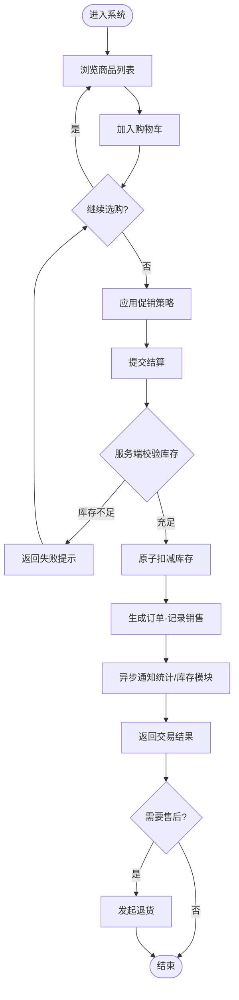
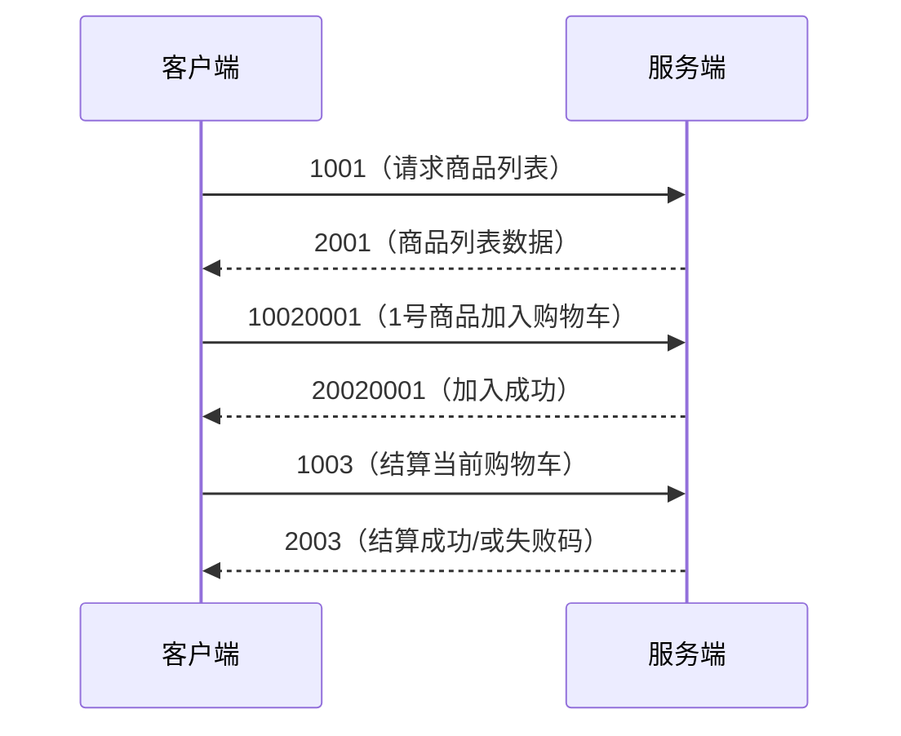
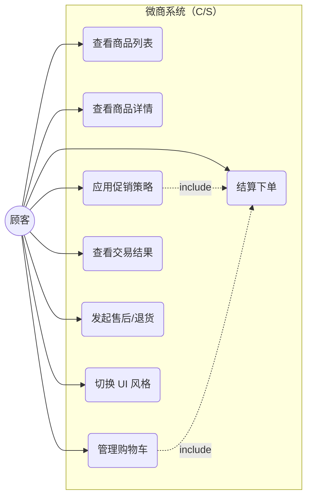
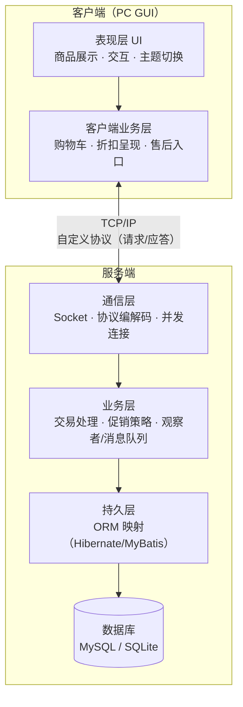

# 微商系统课程设计 — 需求描述与技术讨论

> 本文档回答两个问题：**① 这个系统具体要做什么（需求）**，**② 用什么技术做、遇到不熟的怎么办（技术方案）**。
> 配套文档：《微商系统课程设计-深度理解与设计思路.md》提供背景、架构思想和考核解读。

---

## 目录

- [一、项目需求描述](#一项目需求描述)
  - [1. 功能需求](#1-功能需求)
    - [1.1 业务逻辑](#11-业务逻辑)
    - [1.2 UI 描述](#12-ui-描述)
    - [1.3 通信](#13-通信)
  - [2. 性能需求](#2-性能需求)
    - [2.1 多层结构](#21-多层结构)
    - [2.2 柔性讨论](#22-柔性讨论)
    - [2.3 扩展能力](#23-扩展能力)
  - [3. 用例图](#3-用例图)
  - [4. 系统框图](#4-系统框图)
- [二、可能的相关技术讨论](#二可能的相关技术讨论)
  - [1. 技术全景图](#1-技术全景图)
  - [2. 技术熟悉度自查表](#2-技术熟悉度自查表)
  - [3. 不熟悉技术的解决路径](#3-不熟悉技术的解决路径)
  - [4. 选型对比与决策](#4-选型对比与决策)

---

## 一、项目需求描述

### 1. 功能需求

#### 1.1 业务逻辑

**系统定位**：一个运行在 PC 上的 C/S（客户端/服务器）架构社交电商系统，单店经营、多用户访问，功能对标拼多多/有赞/微店的交易闭环（课程约定：PC 实现、不考虑手机、不考虑多店、但考虑多用户）。

**核心业务实体**：

| 实体 | 含义 | 主要属性 |
|------|------|----------|
| 用户（User） | 买家账号 | 账号、密码、昵称、联系方式 |
| 商品（Product） | 在售商品 | 编号、名称、价格、库存、描述 |
| 购物车（Cart/CartItem） | 用户的待购清单 | 用户、商品、数量 |
| 订单（Order） | 交易结果 | 订单号、用户、明细、金额、时间 |
| 促销策略（Promotion） | 打折/降价/券 | 类型、参数、适用范围 |

**业务流程（按模块）**：

1. **商品浏览**
   - 客户端向服务端请求商品列表；服务端从数据库读取并返回。
   - 用户可查看单个商品的名称、价格、库存、描述。

2. **购物车管理**
   - 用户将商品加入购物车（记录商品 + 数量）。
   - 支持修改数量、删除条目、查看购物车。

3. **促销（核心亮点，混合策略）**
   - 支持三类促销：**打折**（统一折扣、第 2 件 9 折第 3 件 8 折、免单）、**降价**（直降）、**券**（满减/抵扣）。
   - 促销可**叠加**，计算以**服务端为权威**（防止客户端篡改价格）。
   - 用**反射 + 策略 + 装饰**等设计模式实现（详见《深度理解》§8）。

4. **结算**
   - 汇总购物车 → 应用促销 → 计算应付金额。
   - 校验并**原子扣减库存**（互斥，防超卖）。
   - 生成订单、记录销售信息。

5. **售后服务**
   - 对已成交订单发起退货申请，服务端记录售后状态。

6. **UI 风格切换**
   - 提供多套 UI 主题/风格，用户可切换（体现表现层与业务层解耦）。

**业务主流程（活动图）**：



#### 1.2 UI 描述

客户端是 PC 桌面 GUI，采用 MVC 分层，UI 层只做展示与交互，不写业务规则。核心界面清单：

| 界面 | 主要内容 | 交互 |
|------|----------|------|
| 登录/注册 | 账号密码输入 | 校验后进入主界面 |
| 商品列表 | 商品卡片（图/名/价/库存） | 点击查看、加入购物车 |
| 商品详情 | 完整描述、促销信息 | 选择数量、加入购物车 |
| 购物车 | 条目列表、数量增减、删除 | 修改后实时刷新小计 |
| 促销/优惠 | 展示可用折扣/券 | 选择或自动应用 |
| 结算 | 结算单、应付金额 | 确认提交订单 |
| 订单/交易结果 | 成功/失败提示、订单号 | 查看明细、发起售后 |
| 售后 | 退货申请表单 | 提交申请 |
| 设置 | UI 主题风格切换 | 即时换肤 |

**UI 设计原则**：
- UI 层**不参与**促销计算、库存扣减等业务规则，只负责**发起请求 + 展示结果**。
- "风格不同 UI 选择"要求 UI 可主题化：抽离颜色/字体/布局为可替换的样式配置。

#### 1.3 通信

**通信模型**：TCP/IP 上的**自定义应用层协议**，双向（请求/应答）。

**报文格式（可选定长/不定长）**：

| 字段 | 长度 | 说明 |
|------|------|------|
| 魔数 | 2 字节 | 固定值（如 `0xA55A`），用于快速校验合法报文 |
| 版本 | 1 字节 | 协议版本号 |
| 类型 | 1 字节 | `1`=请求，`2`=应答 |
| 功能码 | 4 字节 | 标识具体操作（见下表） |
| 数据长度 | 4 字节 | 数据体字节数（不定长用；定长可省略） |
| 数据体 | 变长 | 序列化后的业务数据（JSON 或自定义序列化） |

**功能码编码规则**（源自 PPT 第 12 页示例）：

> `1xxx` = 请求，`2xxx` = 应答；中间位 = 功能模块；后四位 = 商品编号。

| 方向 | 功能码 | 含义 |
|------|--------|------|
| 请求 | `1001` | 请求商品列表 |
| 应答 | `2001` | 返回商品列表 |
| 请求 | `1002XXXX` | 将 `XXXX` 号商品加入购物车 |
| 应答 | `2002XXXX` | `XXXX` 号商品加入购物车成功 |
| 请求 | `1003` | 结算当前购物车 |
| 应答 | `2003` | 结算成功 |
| 请求 | `1004` | 发起售后/退货 |
| 应答 | `2004` | 售后受理结果 |
| 请求 | `1005` | 切换 UI 风格/查询配置 |
| 应答 | `2005` | 返回配置 |

**通信时序**：



**通信约束**：
- 支持**同步**（阻塞等应答）与**异步**（请求发出后继续其他操作，应答回调处理）两种模式，课程鼓励实现异步（配合观察者模式 + 消息队列）。
- 协议**语言无关**（纯字节流），因此客户端与服务端可用不同语言（如 Java + C++ 跨语言）。

---

### 2. 性能需求

#### 2.1 多层结构

系统必须采用**多层（分层）架构**，各层职责单一、通过接口协作：

| 层 | 位置 | 职责 | 技术载体 |
|----|------|------|----------|
| 表现层（UI） | 客户端 | 展示、交互、主题切换 | Swing/JavaFX/Qt |
| 客户端业务层 | 客户端 | 购物车、折扣呈现、售后入口 | Java/C++ 业务类 |
| 通信层 | 两端 | Socket、协议编解码、并发连接管理 | TCP/IP + 自定协议 |
| 服务端业务层 | 服务端 | 交易处理、促销策略、观察者/消息队列 | Java 业务类 |
| 持久层 | 服务端 | 对象↔关系映射 | Hibernate/MyBatis/JDBC |
| 数据库层 | 服务端 | 数据存储、SQL、事务 | MySQL/SQLite |

**要求**：跨层调用只能通过接口/协议，**禁止跨层直连**（如 UI 直接操作数据库）。

#### 2.2 柔性讨论

"柔性"指系统对**变化的适应能力**，是分层设计的直接收益。本项目重点体现的柔性维度：

1. **数据层柔性**：换数据库（MySQL ↔ SQLite）不影响业务层——靠持久层隔离。
2. **持久化柔性**：换 ORM（Hibernate ↔ MyBatis ↔ 手写 JDBC）不影响业务层。
3. **通信柔性**：同步 ↔ 异步切换，业务逻辑不变——靠通信层隔离。
4. **平台/语言柔性**：客户端语言（Java/C++）可换，服务端无感知——靠协议的语言无关性。
5. **表现层柔性**：UI 主题/风格可切换——靠 UI 与业务的解耦。
6. **业务规则柔性**：促销玩法可增改——靠策略模式 + 反射的动态装配。

**衡量标准**：修改上述任一项，其余层的代码应**尽量零改动**。

#### 2.3 扩展能力

系统应支持**开闭原则**（对扩展开放、对修改封闭），具体扩展点：

| 扩展点 | 当前 | 可扩展为 | 实现机制 |
|--------|------|----------|----------|
| 促销玩法 | 打折/降价/券 | 满减、秒杀、拼团、会员价 | 反射 + 策略（新增类 + 改配置） |
| 促销叠加 | 两种叠加 | N 种叠加 | 装饰模式 |
| 商品类型 | 基础商品 | 多规格、多图片 | 表结构扩展 |
| 用户体系 | 单角色买家 | 会员等级、积分 | 数据模型扩展 |
| 通信功能码 | 十余个 | 按模块无限扩展 | 协议预留编码空间 |
| 客户端形态 | PC GUI | 多终端（只要遵守协议） | 协议解耦 |
| 服务端部署 | 单机 | 分布式（消息队列、集群） | 观察者/队列解耦 |

> 第 17 页评分中"功能极简、无扩展"为最低档，因此**扩展能力不是可选项，而是评分硬指标**。

---

### 3. 用例图



**用例说明（文字版，兼容无渲染环境）**：

```
┌─────────────────── 微商系统（系统边界） ───────────────────┐
│                                                            │
│   ○ 查看商品列表   ○ 查看商品详情                            │
│   ○ 管理购物车     ○ 应用促销策略（打折/降价/券）             │
│   ○ 结算下单       ○ 查看交易结果                            │
│   ○ 发起售后/退货   ○ 切换 UI 风格                           │
│                                                            │
└────────────────────────────────────────────────────────────┘
        ▲          ▲          ▲
        │          │          │
      [顾客]    [顾客]      [顾客]
      （主要参与者：买家；结算依赖购物车与促销两个用例）
```

- **参与者**：顾客（买家）为主；系统可预留"管理员"管理商品/库存（单店场景可合并）。
- **关系**：`结算下单` **包含** `管理购物车` 与 `应用促销策略`（include）。

---

### 4. 系统框图

**总体架构框图**：



**部署图（文字版）**：

```
┌──────────────┐         ┌──────────────────────────────┐
│   PC 客户端   │         │        服务器（PC）            │
│  ┌─────────┐ │  TCP/IP │ ┌─────────────┐  ┌─────────┐ │
│  │ UI 层    │ │◄──────►│ │ 通信/业务层  │  │ 数据库  │ │
│  │ 业务层   │ │  自定协议│ │ 持久层      │─▶│ MySQL/  │ │
│  └─────────┘ │         │ └─────────────┘  │ SQLite │ │
└──────────────┘         └──────────────────────────────┘
```

---

## 二、可能的相关技术讨论

### 1. 技术全景图

按系统分层，把可能用到的技术列全：

| 类别 | 技术 | 在本项目中的作用 |
|------|------|------------------|
| 编程语言 | Java、C++、C# | 服务端（Java 推荐）/ 客户端（Java 或 C++，体现跨语言） |
| GUI | Java Swing、JavaFX、C++ Qt、C# WinForms/WPF | 客户端界面与交互 |
| 网络通信 | TCP/IP、Socket、序列化 | 客户端↔服务端通信 |
| 协议设计 | 自定义报文（魔数/版本/类型/功能码/数据体） | 通信层核心交付物 |
| 并发编程 | 多线程、线程池、synchronized/ReentrantLock、volatile | 多用户并发、库存互斥 |
| 数据库 | MySQL、SQLite | 存储商品/用户/销售 |
| SQL | DDL/DML/DQL | 建表、增删改查 |
| 持久化框架 | Hibernate、MyBatis、JDBC | 对象↔关系映射 |
| 设计模式 | 策略、装饰、观察者、工厂、单例、MVC | 促销、异步解耦、分层 |
| 反射 | Java Reflection / C++ RTTI | 动态装配促销策略 |
| 异步解耦 | 消息队列（可自实现或选型） | 交易完成事件分发 |
| 建模 | UML（用例/类/时序/活动/部署图） | 分析与设计文档 |
| 工程 | 软件工程生命周期、版本管理（Git）、测试 | 全程管理 |
| 工具 | IDEA/Eclipse、MySQL Workbench、DB Browser for SQLite、Git | 开发环境 |

### 2. 技术熟悉度自查表

> 下表按"零基础学生"的典型水平预设了熟悉度，**请根据你的实际情况在"我的自评"列如实标注**（熟 / 会点 / 没接触），然后对照第 3 节取用对应的解决路径。

| 技术 | 典型熟悉度 | 我的自评 | 本项目要求 |
|------|-----------|----------|-----------|
| Java 基础语法 |不熟悉| ____ | 服务端主力语言 |
| C++ / C# 基础 | 熟悉其一 | ____ | 客户端可选语言 |
| 面向对象（类/继承/多态/接口） | 熟悉 | ____ | 全部设计的基础 |
| SQL 基础 | 会点 | ____ | 建表 + 增删改查 |
| UML 建模 | 没接触 | ____ | 需求/设计文档必备 |
| Socket / TCP 通信 | 没接触 | ____ | 通信层核心 |
| 多线程 / 并发 | 没接触 | ____ | 并发互斥难点 |
| 设计模式 | 没接触 | ____ | 促销/异步核心 |
| 反射机制 | 没接触 | ____ | 促销可扩展 |
| ORM（Hibernate/MyBatis） | 没接触 | ____ | 持久层 |
| GUI 编程（Swing/Qt 等） | 会点 | ____ | 客户端界面 |
| 消息队列 | 没接触 | ____ | 异步解耦（加分） |

### 3. 不熟悉技术的解决路径

针对上表中"没接触/会点"的技术，逐项给出**可落地的解决路径**（含学习资源方向、最小实践、备选方案）：

#### 3.1 Socket / TCP 通信（最重要，优先解决）

- **解决路径**：
  1. 先搞懂概念：TCP 三次握手、`ServerSocket`/`Socket`、输入输出流。
  2. 最小实践：跑通"客户端发一句话 → 服务端回一句话"的 Java Socket 例程。
  3. 进阶：解决**粘包/半包**（定长报文或包头带长度）、**多客户端**（为每个连接开线程/线程池）。
  4. 落地：把 1.3 节的协议报文实现出来。
- **资源方向**：教材网络编程章节、Java Socket 官方教程、搜索"Java Socket 聊天室"。
- **备选方案**：若时间紧，可先做**定长报文 + 同步阻塞**的最简版，稳定后再升级不定长/异步。

#### 3.2 多线程 / 并发

- **解决路径**：
  1. 基础：`Thread`、`Runnable`、`synchronized`、`volatile`、`ReentrantLock`。
  2. 最小实践：多线程同时对一个计数器 `++`，观察竞态，再用锁修正。
  3. 落地：服务端多客户端连接管理 + 库存原子扣减（`UPDATE ... WHERE num>0` 或加锁）。
- **资源方向**：《Java 并发编程实战》入门章节、"Java 并发" 系列博客。
- **备选方案**：互斥可优先用**数据库事务 + SQL 条件更新**实现（`UPDATE stock SET num=num-1 WHERE id=? AND num>0`，检查影响行数），比手写锁更简单可靠。

#### 3.3 设计模式

- **解决路径**：
  1. 只重点学 5 个：**策略、装饰、观察者、工厂、单例**（够用且贴合项目）。
  2. 每个模式做一张"意图 + 结构图 + 一段示例代码"笔记。
  3. 落地：促销用"策略 + 装饰 + 反射"，交易通知用"观察者"。
- **资源方向**：《Head First 设计模式》或《大话设计模式》对应章节。
- **备选方案**：模式不是越多越好，讲清 2~3 个贴合场景的即可达标，重点是**能画类图、能解释为什么用**。

#### 3.4 反射机制

- **解决路径**：
  1. Java：`Class.forName`、`newInstance`、`Method.invoke`；C++ 用工厂 + 注册表替代（C++ 无原生反射，可手写"类注册表"实现同等效果）。
  2. 最小实践：把类名写进配置文件，反射实例化并调用其方法。
  3. 落地：促销策略按配置动态加载。
- **资源方向**：Java Reflection 官方文档、搜索"Java 反射 动态加载类"。
- **备选方案**：若 C++ 客户端做促销，用**工厂模式 + 注册表**替代反射，效果等价、更直观。

#### 3.5 ORM / 持久层（Hibernate / MyBatis）

- **解决路径**：
  1. 先手写 **JDBC**（`Connection`/`PreparedStatement`/`ResultSet`）完成一次"对象存入表、表读回对象"，理解映射的本质。
  2. 再引入 MyBatis（比 Hibernate 更轻、更易入门）：写 Mapper XML + SQL。
  3. 落地：商品、用户、订单三张表的读写。
- **资源方向**：MyBatis 官方中文文档、搜索"MyBatis 快速入门"。
- **备选方案**：**完全手写 JDBC 封装也完全符合要求**（PPT 只要求"持久层完成映射"，未强制用框架），且更能体现对映射的理解——答辩时反而加分。

#### 3.6 UML 建模

- **解决路径**：
  1. 只需掌握 4 类图：**用例图、类图、时序图、活动图**（部署图可选）。
  2. 用工具画：PlantUML（文本生成，可配 Mermaid）、StarUML、draw.io、或手画。
  3. 落地：本文档已给出用例图/框图/时序图，补一张**类图**（促销相关类）即可。
- **资源方向**：搜索"UML 类图 关系 依赖 泛化 实现 关联"速查图。
- **备选方案**：类图至少画出"策略模式"相关的接口与实现类及其关系。

#### 3.7 GUI 编程（Swing / JavaFX / Qt）

- **解决路径**：
  1. 选一个最熟的（会 Java 就 Swing，会 C++ 就 Qt）。
  2. 最小实践：一个窗口 + 几个按钮 + 一个列表 + 事件响应。
  3. 落地：商品列表用表格/卡片展示，购物车用可编辑列表，主题切换用资源抽离。
- **资源方向**：Swing 官方教程、Qt Creator 官方示例。
- **备选方案**：GUI 不追求美观，**功能可用 + 结构分层清晰**即可（考核看架构与逻辑，不看颜值）。

#### 3.8 消息队列 / 异步通信

- **解决路径**：
  1. 先理解"观察者模式 + 一个简单的线程安全队列"即可实现**最小消息队列**。
  2. 最小实践：交易完成后，往队列发事件，多个监听者（库存/订单/统计）异步消费。
  3. 落地：服务端业务层内实现发布/订阅。
- **资源方向**：观察者模式 + 自实现 `BlockingQueue`（Java 内置 `ArrayBlockingQueue`）。
- **备选方案**：**异步通信是加分项而非必做**，可先用同步通信跑通全部功能，再抽取时间升级异步；不引入 RabbitMQ 等重中间件（自实现更能体现理解）。

### 4. 选型对比与决策

| 决策点 | 选项 | 推荐 | 理由 |
|--------|------|------|------|
| 服务端语言 | Java / C++ / C# | **Java** | PPT 明确"Java 支持"，生态成熟，反射/ORM/并发资料多 |
| 客户端语言 | Java / C++ | Java 或 C++ | 若做"跨语言"亮点则选 C++，否则与服务端同语言降低心智负担 |
| 通信方式 | 同步 / 异步 | 先同步后异步 | 同步保证功能交付，异步作为难点加分 |
| 持久层 | Hibernate / MyBatis / JDBC | MyBatis 或 JDBC | 更易入门、SQL 可控，且能讲清映射原理 |
| 数据库 | MySQL / SQLite | SQLite 起步 | 零部署、单文件，PC 教学场景最省事；后期可切 MySQL 展示"数据层柔性" |
| 促销实现 | 反射+策略+装饰 | 全部用上 | PPT 点名，是核心亮点与评分点 |
| 消息队列 | 自实现 / 中间件 | 自实现 | 轻量、体现原理理解，符合"去框架化"主旨 |

---

## 附：需求要点速查

1. **功能**：商品浏览、购物车、促销（打折/降价/券，可叠加）、结算、售后、UI 主题切换。
2. **性能**：多层架构、柔性（六维可替换）、扩展（开闭原则）、并发与互斥。
3. **通信**：TCP/IP 自定协议，`1xxx` 请求 / `2xxx` 应答，定长或不定长，双向。
4. **技术栈建议**：Java（服务端）+ Java/C++（客户端）+ Socket + MySQL/SQLite + MyBatis/JDBC + 策略/装饰/观察者/反射。
5. **不熟悉项**：优先攻克 **Socket、并发、设计模式** 三个，其余（UML、ORM、GUI、消息队列）按第 3 节路径逐步补齐。
