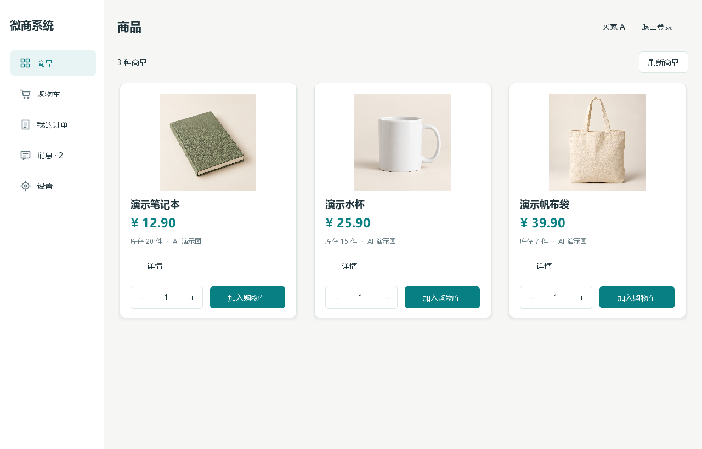
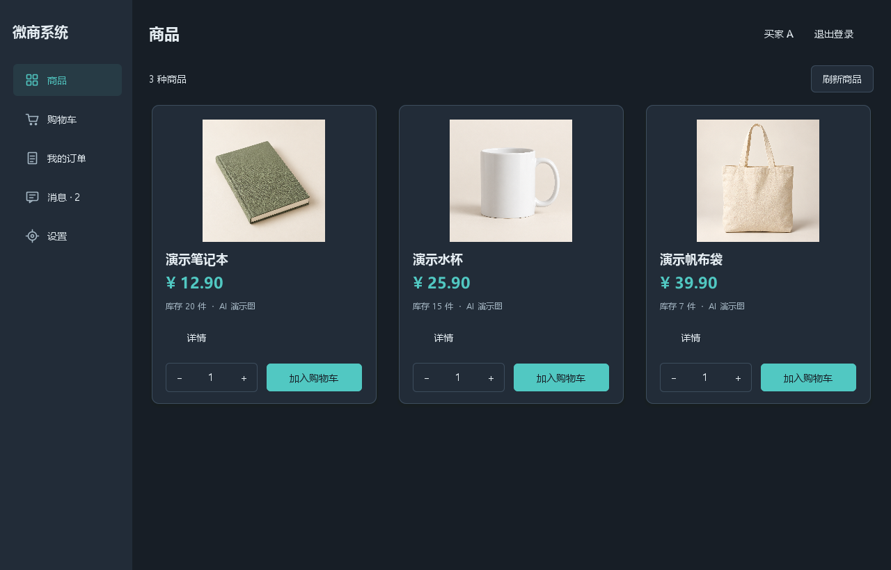
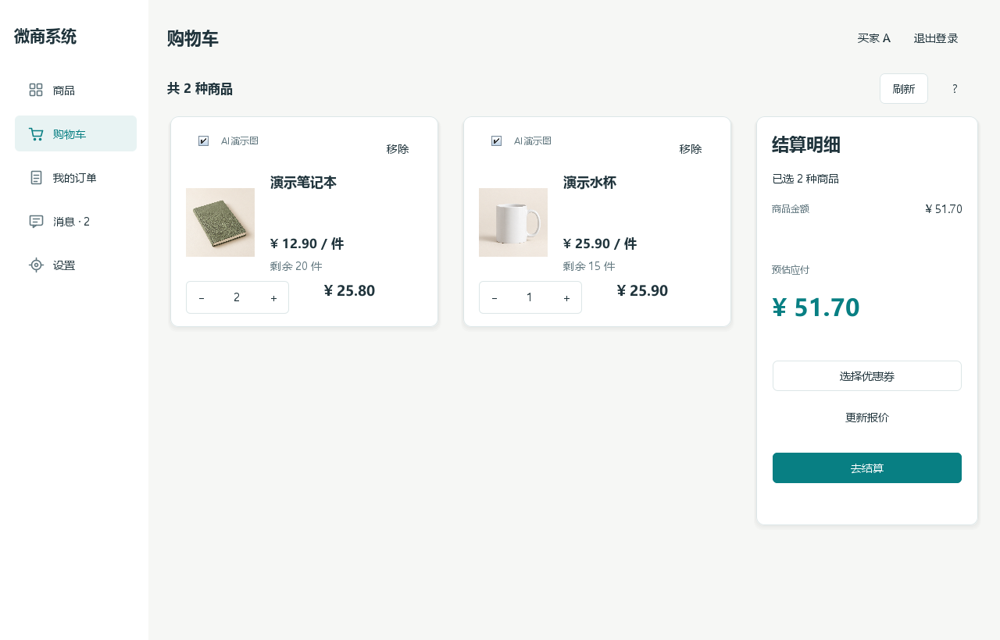
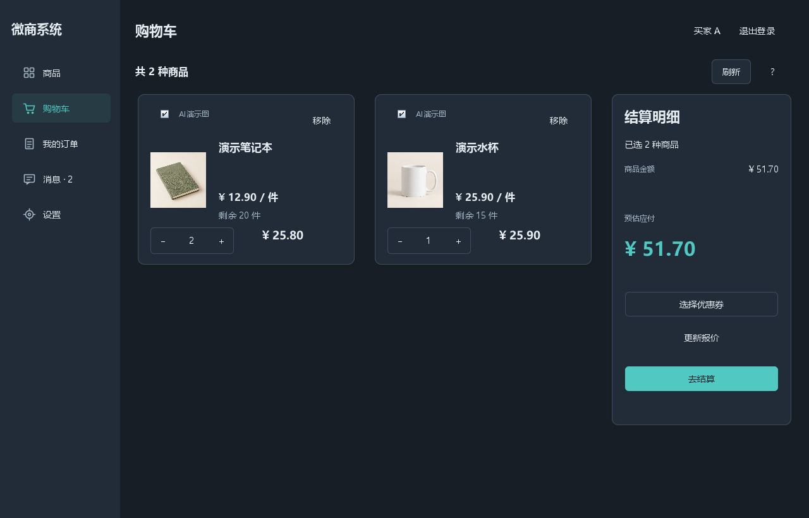
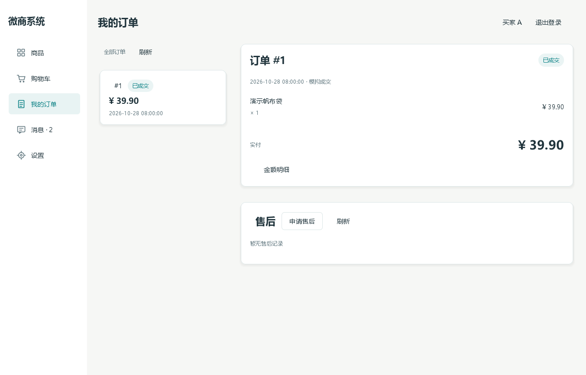
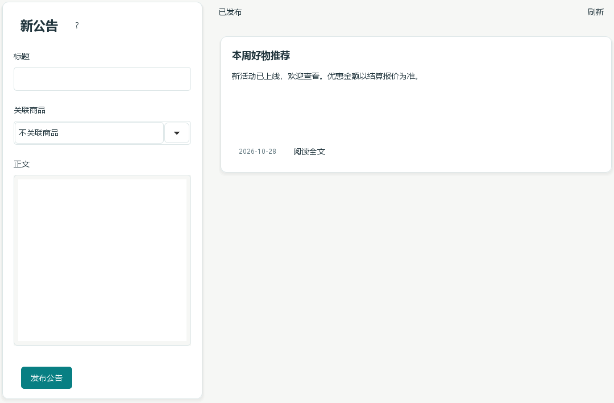

# 界面预览

2026-10-28，按用户反馈重新进行S14a界面整理，UI26/UI27已确认采用。以下来自实际Swing组件、现有控制器/TCP及临时SQLite数据；侧栏采用实际NavigationPane。没有自动输入原生窗口口令，完整窗口与键盘操作仍待用户试用。

## 商品与导航

统一左导航、页面标题和账号区。商品保留网格、图片、卡内数量与加入；商品说明按需展开，分页仅在需要时出现。

## 购物车

商品卡只保留名称、有效单价、库存、数量与小计，优惠为零时不重复展示。右侧显示金额及结算操作；数量键盘/加减自动保存、卡内勾选和移除保持。券失效、金额变化与未知结果恢复均按需提示，不隐藏确认金额。

## 订单与售后

列表与详情分区，状态标签和金额优先；售后为时间线/状态卡。点“申请售后”才打开表单，金额明细及完整处理记录按需查看。游客和空状态不再铺满空白表单。

## 管理端公告

编辑卡与已发布卡片分开，字段短标签、关联商品选择、正文独立输入。管理端促销/券/售后也采用统一间距与组件；完整规则收入帮助。

## 设计依据与验证

采用24px分组间距、28px页面留白、20px卡片圆角、轻阴影和细边框；沿用蓝绿色浅/深主题，未改变业务分层。参考[Fluent 2布局](https://fluent2.microsoft.design/layout)的空间分组原则及[层级与阴影](https://fluent2.microsoft.design/elevation/)，落地为本仓库的Swing组件。

完整verify 427项通过（109/9/55/254），包括新导航/输入尺寸/加减按钮、未知成交恢复可见、售后空表单不写入。预览是组件检查，不替代用户接受实际窗口。
